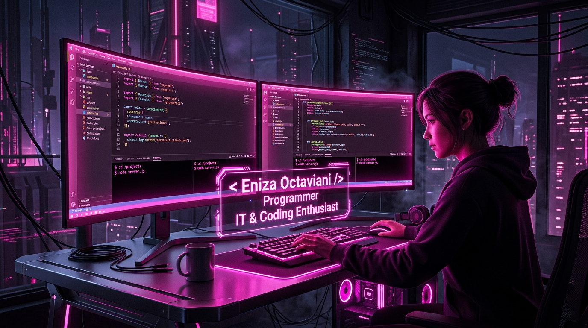

<div align="center">
  <!-- 🌸 Hero Coding Banner in #e942f5 (Ukuran sedang / standar) -->
  <a href="https://github.com/enizaoctaviani">
    
  </a>

  <br/><br/>

  <!-- Monospace IT Coding Typing SVG with #e942f5 Accent -->
  <a href="https://github.com/enizaoctaviani">
    
  </a>

  <br/>

  <!-- IT & Coding Telemetry Badges in #e942f5 -->
  <p align="center">
    <code>$ systemctl status programmer-it-coding.service --active</code>
    <br/><br/>
    
    
    
    
    
    
    <a href="mailto:enizaoktaviani@gmail.com">
      
    </a>
  </p>
</div>

---

### 💻 `// 01. IT_CODING_PROFILE.ts`

```typescript
/**
 * @file eniza_it_coding.ts
 * @role Programmer IT & Coding Specialist
 * @author Eniza Octaviani (@enizaoctaviani)
 * @tagline "Pink Life pink person"
 * @themeAccent #e942f5
 */

interface IITCodingProfile {
  identity: {
    namaLengkap: string;
    namaPanggilan: string;
    username: string;
    role: string;
    status: string;
    tagline: string;
  };
  specialization: string[];
  themeColor: string;
  codingStack: {
    languages: string[];
    frontend: string[];
    backend: string[];
    databases: string[];
    tools: string[];
  };
  codingPhilosophy: string;
}

export const enizaIT: IITCodingProfile = {
  identity: {
    namaLengkap: "Eniza Octaviani",
    namaPanggilan: "Eniza",
    username: "enizaoctaviani",
    role: "Programmer IT & Coding Enthusiast 💻⚡",
    status: "Mahasiswa IT 🎓",
    tagline: "Pink Life pink person 🌸💖"
  },
  specialization: [
    "Full-Stack Web Coding & Engineering",
    "Database Architecture & API Integration",
    "Clean, Structured, & Maintainable Code",
    "Creative & Aesthetic UI/UX Development"
  ],
  themeColor: "#e942f5",
  codingStack: {
    languages: ["TypeScript", "JavaScript", "Python", "PHP", "HTML5", "CSS3", "SQL"],
    frontend: ["React.js", "Next.js", "Tailwind CSS", "Bootstrap"],
    backend: ["Node.js", "Express.js", "RESTful APIs"],
    databases: ["MySQL", "PostgreSQL", "MongoDB"],
    tools: ["Git", "GitHub", "VS Code", "Postman", "Linux", "Figma", "Vite"]
  },
  codingPhilosophy: "Code is like humor. When you have to explain it, it’s bad. Keep it clean, scalable & aesthetic!"
};
```

---

### 🖥️ `// 02. IT_CODING_TERMINAL.sh`

```bash
[eniza@it-coding-station ~]$ neofetch --it-coding
         /\_/\         eniza@dev-universe
        ( o.o )        ------------------
         > ^ <         Role: Programmer IT & Coding Enthusiast
                       Focus: Full-Stack Web Development & Software Engineering
                       Host: High-End Developer Rig
                       OS: Linux / Windows 11 Pro
                       Shell: zsh 5.9 (Coding Environment)
                       Theme: Programmer IT (#e942f5 Cyber Neon)
                       Primary Activity: Coding, Debugging & Building Systems ⚡
                       Motto: "Pink Life pink person" 🌸💖

[eniza@it-coding-station ~]$ cat daily_coding_status.log
✓ [ENGINE]   : Active Coding Engine loaded with #e942f5 neon vibe
✓ [PROJECTS] : Building modern interactive web applications
✓ [GOAL]     : Mengasah keahlian sebagai Programmer IT profesional & inovatif
✓ [MOTTO]    : "Pink Life pink person" // Passionate in Coding 🚀
```

---

### 🛠️ `// 03. CODING_TECH_STACK_&_FRAMEWORKS.json`

```json
{
  "system": "IT Coding Environment",
  "developer": "Eniza Octaviani",
  "themeAccent": "#e942f5",
  "codingDependencies": {
    "programmingLanguages": ["TypeScript", "JavaScript", "Python", "PHP", "HTML5", "CSS3", "SQL"],
    "frontendFrameworks": ["React.js", "Next.js", "TailwindCSS", "Bootstrap"],
    "backendAndDatabases": ["Node.js", "Express.js", "MySQL", "PostgreSQL", "MongoDB"],
    "devTools": ["Git", "GitHub", "VS Code", "Postman", "Linux", "Vite", "Figma"]
  }
}
```

<div align="center">
  <p align="center">
    
    
    
    
    
    
    
    
    
    
    
    
    
    
    
  </p>
</div>

---

### 📊 `// 04. GITHUB_CODING_STATS_&_METRICS.log`

<div align="center">
  <code>/* Querying Coding Telemetry for @enizaoctaviani with #e942f5 Neon Glow */</code>
  <br/><br/>

  <!-- Stats & Top Languages Cards with #e942f5 Border & Theme -->
  <a href="https://github.com/enizaoctaviani">
    
  </a>
  <a href="https://github.com/enizaoctaviani">
    
  </a>
</div>

<br/>

<div align="center">
  <!-- GitHub Streak Stats with #e942f5 -->
  <a href="https://github.com/enizaoctaviani">
    
  </a>
</div>

<br/>

<div align="center">
  <!-- Contribution Activity Graph with #e942f5 -->
  
</div>

---

### 🏆 `// 05. CODING_ACHIEVEMENTS.json`

<div align="center">
  <a href="https://github.com/enizaoctaviani">
    
  </a>
</div>

---

### 💬 `// 06. PROGRAMMER_QUOTE.sh`

<div align="center">
  
</div>

---

### 📡 `// 07. IT_CODING_PROTOCOL.http`

```http
### Contact Programmer IT
POST /api/v1/ping HTTP/1.1
Host: api.eniza.dev
Content-Type: application/json

{
  "target": "Eniza Octaviani",
  "role": "Programmer IT & Coding Enthusiast",
  "themeColor": "#e942f5",
  "motto": "Pink Life pink person 🌸⚡",
  "email": "enizaoktaviani@gmail.com",
  "message": "Let's collaborate on code, technology projects, or open-source!"
}
```

<div align="center">
  <p><code>// Protocol Endpoints &amp; Quick Connect</code></p>

  <a href="mailto:enizaoktaviani@gmail.com" target="_blank">
    
  </a>
  &nbsp;
  <a href="https://github.com/enizaoctaviani" target="_blank">
    
  </a>
  &nbsp;
  <a href="https://www.linkedin.com/" target="_blank">
    
  </a>
  &nbsp;
  <a href="https://instagram.com/" target="_blank">
    
  </a>
</div>

<br/>

<div align="center">
  <code>/* return process.exit(0); -- Programmer IT // IT Coding // Pink Life pink person 🌸⚡ */</code>
  <br/><br/>
  <!-- IT Programmer & Coding Footer Banner: Gradient #e942f5 -> #0d020d -> #e942f5 -->
  
</div>
