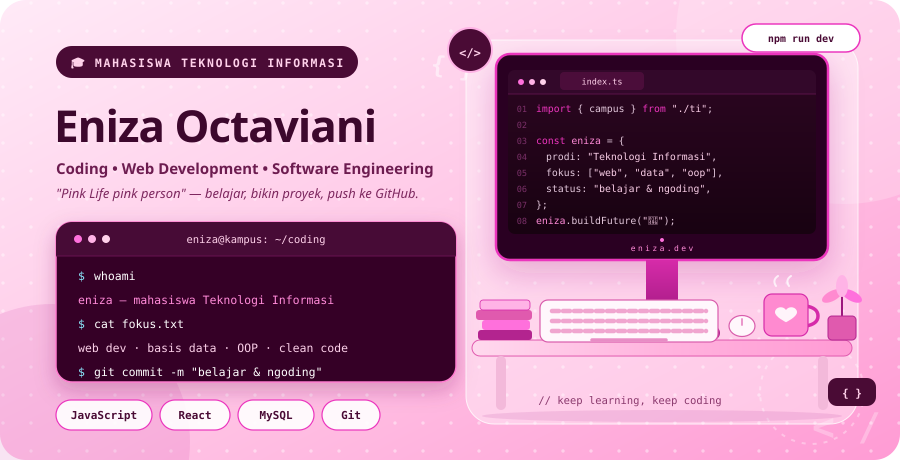
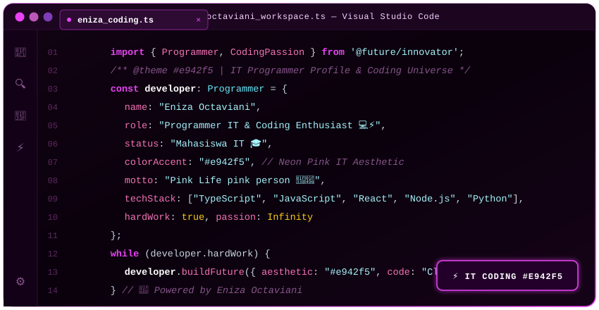

<div align="center">
  <!-- 🌸 Dynamic Header Banner Mahasiswa Teknologi Informasi in #eb34bd -->
  

  <br/>

  <!-- Cover Pink Mahasiswa TI & Coding (SVG, bukan gambar AI) -->
  <a href="https://github.com/enizaoctaviani">
    
  </a>

  <br/><br/>

  <!-- Monospace IT Coding Typing SVG with #eb34bd Accent -->
  <a href="https://github.com/enizaoctaviani">
    
  </a>

  <br/>

  <!-- IT & Coding Telemetry Badges in #eb34bd -->
  <p align="center">
    <code>$ systemctl status mahasiswa-teknologi-informasi.service --active</code>
    <br/><br/>
    
    
    
    
    
    
    <a href="mailto:enizaoktaviani@gmail.com">
      
    </a>
  </p>

  <br/>

  <!-- Interactive Coding Window Vector Graphic -->
  <a href="https://github.com/enizaoctaviani">
    
  </a>
</div>

---

### 💻 `// 01. MAHASISWA_TI_PROFILE.ts`

```typescript
/**
 * @file mahasiswa_teknologi_informasi.ts
 * @student Eniza Octaviani (@enizaoctaviani)
 * @major Teknologi Informasi (Information Technology)
 * @themeColor #eb34bd
 * @tagline "Pink Life pink person"
 */

interface IMahasiswaTI {
  identitas: {
    namaLengkap: string;
    namaPanggilan: string;
    username: string;
    programStudi: string;
    peran: string;
    status: string;
    tagline: string;
  };
  fokusAkademikDanCoding: string[];
  warnaTema: string;
  stackTeknologi: {
    bahasaPemrograman: string[];
    pengembanganWeb: string[];
    basisData: string[];
    toolsDanLingkungan: string[];
  };
  filosofiBelajar: string;
}

export const enizaTI: IMahasiswaTI = {
  identitas: {
    namaLengkap: "Eniza Octaviani",
    namaPanggilan: "Eniza",
    username: "enizaoctaviani",
    programStudi: "Teknologi Informasi (Information Technology) 🎓",
    peran: "Mahasiswa Teknologi Informasi & Coding Enthusiast 💻⚡",
    status: "Aktif Kuliah & Ngoding Setiap Hari 🚀",
    tagline: "Pink Life pink person 🌸💖"
  },
  fokusAkademikDanCoding: [
    "Algoritma, Logika Pemrograman & Struktur Data",
    "Pemrograman Berorientasi Objek (OOP)",
    "Perancangan Basis Data Relasional & Manajemen Query",
    "Full-Stack Web Development & Integrasi RESTful API",
    "Rekayasa Perangkat Lunak, Clean Code & Git Workflow"
  ],
  warnaTema: "#eb34bd",
  stackTeknologi: {
    bahasaPemrograman: ["JavaScript", "TypeScript", "Python", "PHP", "HTML5", "CSS3", "SQL"],
    pengembanganWeb: ["React.js", "Next.js", "Node.js", "Express.js", "Tailwind CSS", "Bootstrap"],
    basisData: ["MySQL", "PostgreSQL", "MongoDB"],
    toolsDanLingkungan: ["Git", "GitHub", "VS Code", "Postman", "Linux", "Figma", "Vite"]
  },
  filosofiBelajar: "Ngoding bukan sekadar menghafal sintaks, tapi seni memecahkan masalah nyata dengan solusi yang terstruktur, efisien, dan estetis!"
};
```

---

### 🖥️ `// 02. IT_STUDENT_TERMINAL.sh`

```bash
[eniza@laptop-mahasiswa-ti ~]$ neofetch --ti-coding
         /\_/\         eniza@kampus-it
        ( o.o )        ---------------
         > ^ <         Mahasiswa: Eniza Octaviani
                       Program Studi: Teknologi Informasi (TI) 🎓
                       Aktivitas: Kuliah, Ngoding & Bangun Proyek Web 💻
                       Host: Student Developer Rig
                       OS: Linux / Windows 11 Pro
                       Shell: zsh 5.9 (Coding & Academic Workspace)
                       IDE Pilihan: Visual Studio Code
                       Tema: Mahasiswa TI (#eb34bd Neon Magenta) 🌸⚡
                       Motto: "Pink Life pink person" 💖✨

[eniza@laptop-mahasiswa-ti ~]$ cat status_kuliah_ngoding.log
✓ [AKADEMIK] : Menguasai konsep dasar & terapan di bidang Teknologi Informasi
✓ [PRAKTIK]  : Menerapkan algoritma ke dalam aplikasi berbasis web & database
✓ [CODING]   : Menulis clean code, eksplorasi framework modern & debugging
✓ [THEME]    : Modern Coding Aesthetic #eb34bd
✓ [GOAL]     : Menjadi lulusan TI yang handal, adaptif, dan siap berkontribusi 🚀
```

---

### 🛠️ `// 03. CODING_TECH_STACK_&_FRAMEWORKS.json`

```json
{
  "bidang": "Teknologi Informasi (TI)",
  "mahasiswa": "Eniza Octaviani",
  "temaWarna": "#eb34bd",
  "lingkunganCoding": {
    "bahasaPemrograman": ["JavaScript", "TypeScript", "Python", "PHP", "HTML5", "CSS3", "SQL"],
    "frontendFrameworks": ["React.js", "Next.js", "TailwindCSS", "Bootstrap"],
    "backendDanDatabase": ["Node.js", "Express.js", "MySQL", "PostgreSQL", "MongoDB"],
    "developerTools": ["Git", "GitHub", "VS Code", "Postman", "Linux", "Vite", "Figma"]
  }
}
```

<div align="center">
  <p align="center">
    <!-- Languages -->
    
    
    
    
    
    
    <br/>
    <!-- Web Frameworks & Backend -->
    
    
    
    
    
    <br/>
    <!-- Databases & Dev Tools -->
    
    
    
    
    
    
    
  </p>
</div>

---

### 📚 `// 04. MATA_KULIAH_&_FOKUS_PEMBELAJARAN.md`

| Pilar Teknologi Informasi | Topik yang Dipelajari & Dipraktikkan | Implementasi Coding |
| :--- | :--- | :--- |
| 🧠 **Algoritma & Pemrograman** | Logika Komputasi, Struktur Data, Paradigma OOP | Pemecahan masalah dengan Python, TypeScript & JS |
| 🌐 **Rekayasa Web (Full-Stack)** | Frontend interaktif, Backend REST API, State Management | Pembuatan aplikasi modern dengan React & Node.js |
| 🗄️ **Sistem Basis Data** | Desain ERD, Normalisasi, Query Relasional & NoSQL | Manajemen data dengan MySQL, PostgreSQL & MongoDB |
| 🛠️ **Rekayasa Perangkat Lunak** | SDLC, Version Control (Git), Modularitas Kode | Kolaborasi tim di GitHub dengan Clean Code principle |

---

### 📊 `// 05. GITHUB_CODING_STATS_&_METRICS.log`

<div align="center">
  <code>/* Mengambil Telemetri Aktivitas Coding Mahasiswa TI @enizaoctaviani // Aksen #eb34bd */</code>
  <br/><br/>

  <!-- Stats & Top Languages Cards with #eb34bd Border & Theme -->
  <a href="https://github.com/enizaoctaviani">
    
  </a>
  <a href="https://github.com/enizaoctaviani">
    
  </a>
</div>

<br/>

<div align="center">
  <!-- GitHub Streak Stats with #eb34bd -->
  <a href="https://github.com/enizaoctaviani">
    
  </a>
</div>

<br/>

<div align="center">
  <!-- Contribution Activity Graph with #eb34bd -->
  
</div>

---

### 🏆 `// 06. CODING_ACHIEVEMENTS.json`

<div align="center">
  <a href="https://github.com/enizaoctaviani">
    
  </a>
</div>

---

### 💬 `// 07. PROGRAMMER_QUOTE.sh`

<div align="center">
  
</div>

---

### 📡 `// 08. IT_CONNECT_PROTOCOL.http`

```http
### Connect with Mahasiswa Teknologi Informasi
POST /api/v1/mahasiswa-ti/connect HTTP/1.1
Host: api.eniza.dev
Content-Type: application/json

{
  "target": "Eniza Octaviani",
  "programStudi": "Teknologi Informasi (TI)",
  "role": "Mahasiswa TI & Coding Enthusiast 💻⚡",
  "warnaTema": "#eb34bd",
  "motto": "Pink Life pink person 🌸💖",
  "email": "enizaoktaviani@gmail.com",
  "pesan": "Terbuka untuk kolaborasi proyek coding, diskusi teknologi informasi, dan eksplorasi open-source!"
}
```

<div align="center">
  <p><code>// Quick Links &amp; Hubungi Saya</code></p>

  <a href="mailto:enizaoktaviani@gmail.com" target="_blank">
    
  </a>
  &nbsp;
  <a href="https://github.com/enizaoctaviani" target="_blank">
    
  </a>
  &nbsp;
  <a href="https://www.linkedin.com/" target="_blank">
    
  </a>
  &nbsp;
  <a href="https://instagram.com/" target="_blank">
    
  </a>
</div>

<br/>

<div align="center">
  <code>/* return process.exit(0); -- Mahasiswa Teknologi Informasi // Tema Coding #eb34bd // Pink Life pink person 🌸⚡ */</code>
  <br/><br/>
  <!-- Footer Banner: Gradient #eb34bd -> #0f0310 -> #eb34bd -->
  
</div>
